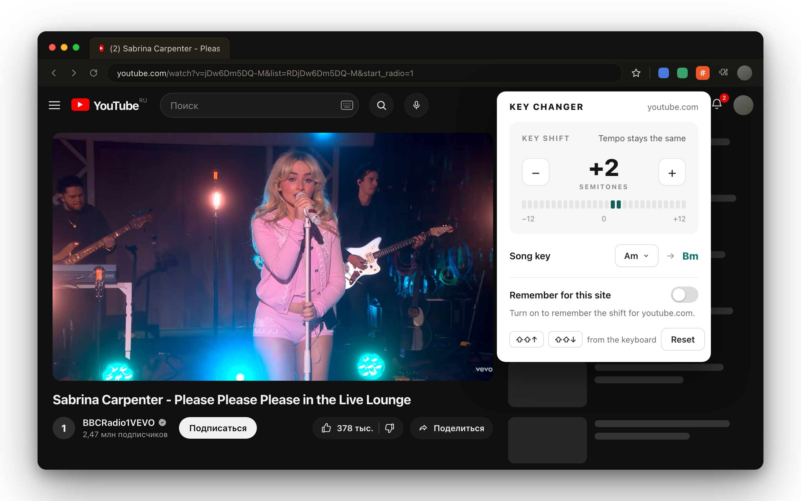

# Key Changer: Pitch Changer Extension for Chrome

This free pitch changer extension shifts the audio of any tab up or down in semitones (12 in each direction, one per press) and leaves the tempo exactly where it was. It works as a youtube pitch shifter: the song's key moves while the video keeps playing at normal speed. If you've been looking for a youtube pitch shifter that doesn't re-render or re-upload anything, this is it. The same trick works on any page with a video or audio player, so it doubles as a general pitch changer. No account, no uploads: the audio is processed on your machine, and the extension makes zero network requests.

  

## What it does

Under the hood it's an audio pitch changer for the browser: it retunes whatever the tab is playing without touching playback speed. Push a song to +12 or down to -12, one press at a time, and the beat never drags or races. As a pitch shifter it stays deliberately small (no library, no project file, no export step) and it works on any page with a video or audio player.

- **Shift range:** ±12 semitones, one semitone per press; tempo is never touched
- **Controls:** click the toolbar icon, or use `Alt+Shift+↑` / `Alt+Shift+↓` / `Alt+Shift+0` (`Option+Shift` on Mac)
- **Song key list:** pick the song's original key and the popup shows what your shift turns it into (E becomes F♯ at +2); the extension does not detect keys by itself
- **Icon badge:** shows the current shift; the next video in the same tab keeps it; a page reload resets it
- **Light and dark theme**
- **Local processing:** no account, no uploads, zero network requests

Unlike a desktop audio pitch changer, there's no import-and-render loop: the tab simply sounds different while it plays. That makes it a practical music pitch changer for practice tracks and backing tracks.

## How to change the key of a song on YouTube

Here's the shortest path to change pitch of a song that's already open in a tab:

1. Open the video, then click the extension's icon in the toolbar. Hotkeys work too: `Alt+Shift+↑` / `Alt+Shift+↓` / `Alt+Shift+0` (`Option+Shift` on Mac).
2. Press up or down to move one semitone at a time. The badge on the icon shows the current shift, so you always know where the song sits.
3. Not sure how far to go? Set the song's original key in the Song key list, and the popup shows the new key for that shift.
4. The next video in the same tab keeps the shift; reload the page to start from zero.

To transpose YouTube audio by four semitones, you press down four times. That is the whole interface. The same steps change video pitch on any site with a player, not just music ones.

## Who it's for

- **Singers** move a backing track into the key they'll perform in instead of straining toward the original.
- **Karaoke crowds** get the same benefit in reverse: the room decides the key, not the recording, so shift until it fits.
- **Guitarists** use it as a quick YouTube transpose: learn the part in the key your capo lives in, without retuning between takes.
- **Teachers** can play one recording in several keys for a class — a music pitch changer in the toolbar replaces the whole file hunt.

None of them need a DAW for this; they need the shift right now, on the page where the song already is.

## Honest limits

A tool that hides its edges isn't worth trusting, so here they are:

- It does **not** detect the song's key. You choose the original key yourself; the extension only does the math.
- It does **not** change speed. Pitch only, by design: tempo and timing stay untouched.
- Shifts of **±6 semitones or more** sound unnatural. Small moves are clean; big ones strain the audio.
- It doesn't run on `chrome://` pages or inside the Chrome Web Store itself.
- DRM-protected audio from paid streaming services is out of reach.
- Some embedded players simply don't respond to it.

## FAQ

### Do I need to upload the song or create an account?

No. If you're after a key changer online free of uploads and sign-ups, this is that: the audio is processed in the tab while the video plays, and the extension makes zero network requests.

### Will it change pitch on other sites?

Yes, any page with a video or audio player. A search for "change pitch online youtube" names the most common case, not the only one. The places it can't reach (browser-internal pages, DRM streams, the occasional unresponsive embedded player) are listed under [Honest limits](#honest-limits) above.

### Is this a pitch shifter extension for speed too?

No. It moves pitch only, within ±12 semitones; the tempo is never touched. If you need a song slowed down for transcription, this is not that tool.

### Does the key changer extension hear the key for me?

It doesn't listen to or analyze anything. You set the song's original key in the Song key list, and the extension shows what your shift turns it into: set E, shift +2, and the popup reads F♯. If you don't know the starting key, that part stays with you.

## Install

Key Changer is free on the Chrome Web Store: **[Install Key Changer](https://chromewebstore.google.com/detail/key-changer/gnidckbifbgpgdkeobdegnnjdkjbbfme)**. One click and the pitch changer waits in your toolbar until a song sits in the wrong key. No account, nothing to set up first.

---

>**Ubah nada dasar lagu langsung di tab YouTube: gratis, tanpa akun**
>
>**Mude o tom da música direto na aba do YouTube: grátis, sem cadastro**

---

*This extension is an independent project, not affiliated with YouTube or Google LLC. YouTube is a trademark of Google LLC.*

## Links

- **[Install — Chrome Web Store](https://chromewebstore.google.com/detail/key-changer/gnidckbifbgpgdkeobdegnnjdkjbbfme)** — free, one click, no account.
- **[Privacy](https://pinwisp.com/key-changer/privacy/)** — privacy policy.
- **[More free tools](https://pinwisp.com)** — other small and honest utilities from the same bench.
